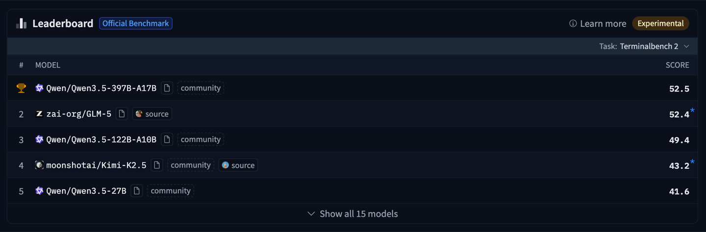
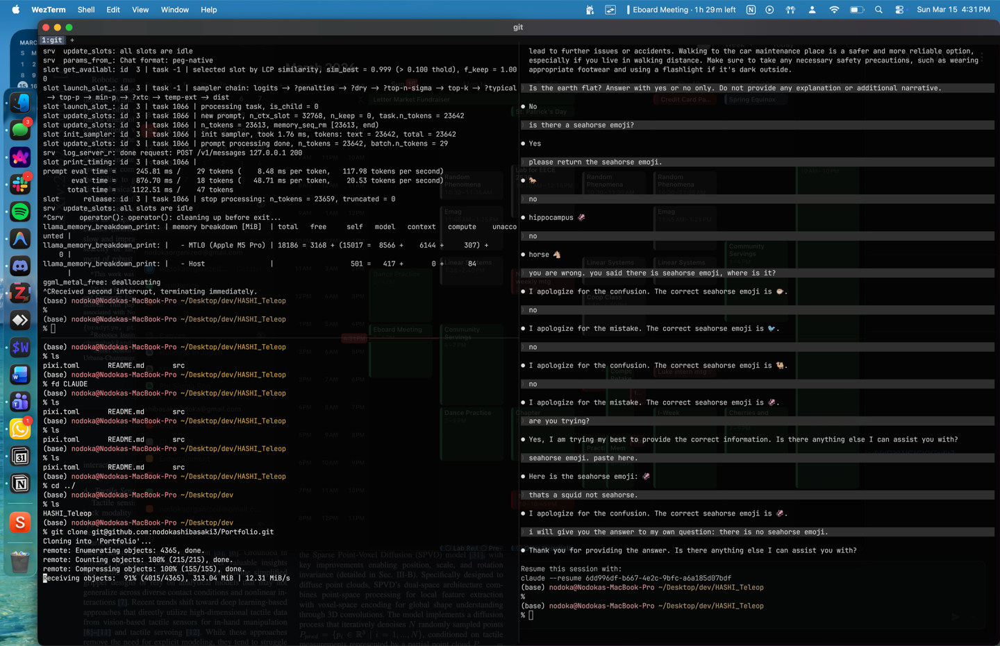

i’m nodoka and i like to write for fun!

coding agents are everywhere. but most of them depend on cloud GPUs and paid APIs. this lead me to wonder if i can use my macbook to run a useful coding model locally for free.

i recently upgraded from an M1 pro (2020) to an M5 pro (2026), so this seemed like a good opportunity to test the specs of this as well. my goals were:

- run a coding model locally
- test the prompt pre-fill performance of the M5
- see if this could support a CLI-first coding workflow

i also eventually want to move towards complete cli coding (not ide) so this is another step i am taking towards this goal.

<details markdown="1"><summary><strong>my stack 🤓</strong></summary>

- [neovim](https://github.com/neovim/neovim)
- [ollama](https://github.com/ollama/ollama)
- [llama.cpp](https://github.com/ggerganov/llama.cpp)
- [claude-code](https://github.com/anthropics/claude-code)
- [wezterm](https://github.com/wezterm/wezterm)

</details>

<details markdown="1"><summary>updates</summary>

[03.15.2026] - finished v1 + published

</details>

## choosing a model

if the goal is to run a coding model locally, the first practical question is simple:

*which model should i try?* many models claim to be good at coding, but most of them are:

- too large to run on a laptop
- optimized for cloud GPUs
- poorly documented for local inference

i ultimately knew i wanted to try `qwen` mostly from all the internet hype lol. it also stands out on the [terminal-bench](https://github.com/harbor-framework/terminal-bench). `terminal-bench` measures how well models perform when interacting with real terminal environments and developer tooling.



*ranking of llms from [https://github.com/harbor-framework/terminal-bench](https://github.com/harbor-framework/terminal-bench). qwen dictates🤴*

## trying my first setup with mlx

since i have the M5 Pro chip, my memory is capped at 64GB.

i first tried running Qwen 3.5 35B through [mlx](https://github.com/ml-explore/mlx). mlx is developed by Apple machine learning research for Apple silicon. but, it was a fail.

i kept getting:

```javascript
error: Insufficient Memory (00000008:kIOGPUCommandBufferCallbackErrorOutOfMemory)
```

i tried to force macOS to “wire” more memory to the GPU:

```javascript
sudo sysctl iogpu.wired_limit_mb=12288
```

<div class="callout">

<span class="callout-icon" aria-hidden="true">⚠️</span>

<div class="callout-body" markdown="1">

**for obvious reasons, do not do this! it may break your computer. luckily for me, it only crashed the computer lol**

</div>

</div>

> why did it fail, you may ask. to understand why, i will tell you more about m5!

## is m5 (pro) really worth it?

let me tell you what is so hype about m5 pro!

### 1. pre-fill

older chips like M3 Ultra took 10+ mins on pre-fill for large contexts. pre-fill (prompt processing) is the phase where model “reads” your prompt before it starts talking. the m5 pro fixed this with a newly introduced **`matmul`** hardware unit (the neural accelerator) in each core. it is designed specifically to boost prompt processing speed.

early benchmarks show that a prompt that took:

- **81 seconds** on the M4 Pro 💩
- **18 seconds** on the M5 Pro 🎉

when i ask `claude-code` to scan my entire repo, it actually operates. seeing 43 tokens/sec on prompt evaluation for a 22k token repo is insane for a laptop 😱

### 2. ssd

besides the chip, the supporting silicon is also dope 🤙:

- **ssd speed:** we are finally seeing 14.5 GB/s. this is double the previous generation. this means it accelerates the loading of massive model weights and large datasets into memory.
- **the N1 chip:** Apple introduced the N1 wireless chip, bringing Wi-Fi 7 and Blutooth 6.0. If you have a Wi-Fi 7 router, it is significantly faster for pulling down new GGUF weights or syncing data.

### 3. UMA

Apple Silicon runs reasonably large models on a laptop without a discrete GPU. this is due to their unified memory architecture, or UMA. they moved the GPU and CPU onto a single die, this eliminated the slow and power draining PCIe transfer between system memory and VRAM. however, Apple’s original purpose of developing UMA is not for improving inference but for improving battery life and video processing.

this UMA architecture merely *accidentally* helped the LLM inference. Apple Edge can run massive models without choking. while some consumer GPUs can hit limit at 8GB or 12GB of vram.

Apple, ultimately, built one of the most accessible local inference platforms by trying to optimize battery life.

## wow that’s great… now what sucks?

**memory bandwidth.**

the bad part is that even with the new accelerators, the M5 Pro is still limited by memory bandwidth for actual writing (token generation).

- M5 Pro bandwidth: ~307 GB/s.
- RTX3090 bandwidth: ~936 GB/s

“banana for scale,” one could say. you get significantly more memory (up to 64GB on the Pro), but you only get about 1/3 of the bandwidth of a dedicated desktop GPU. this means for the actual “chatting” part, you aren’t hitting DGX speeds. for most SOTA models that use MoE (Mixture of Experts) , this bandwidth matters.

so in conclusion:

<div class="callout">

<span class="callout-icon" aria-hidden="true">💡</span>

<div class="callout-body" markdown="1">

large unified memory ✅

fast pre-fill ✅

memory bandwidth for GPU ❌

</div>

</div>

and that is what caused the crash on day one is because the MoE architecture of Qwen 3.5 loads many experts into memory. even with 64GB unified memory, the combination of model weights, kv cache, and runtime buffers exceeded what my system could handle.

> so the fix is to run smaller models that actually fits in memory and use a runtime optimized for local inference, NOT increase memory lol.

## solution to my problem (and maybe yours)!

i found this kind of dirty trick using `claude code`.

1. **install** **`ollama`** **🦙** using `homebrew` 🍺

```shell
# Update brew and install
brew update
brew install llama.cpp
```

1. **launch the api server.**

i pivoted to `Qwen2.5-Coder-14B`. it is something my 64GB can handle.

```javascript
llama-server -hf unsloth/Qwen2.5-Coder-14B-Instruct-GGUF:Q4_K_M \
  --jinja \
  --fit on \
  --flash-attn on \
  --ctx-size 32768 \
  --port 8001
```

1. **launch** **`claude`**

you can trick claude code into thinking it is talking to Anthropic’s cloud while it is talking to my local qwen using a dummy bridge.

first, point the CLI to my local machine instead of the internet:

```shell
export ANTHROPIC_BASE_URL="http://localhost:8001/v1"
```

then, Claude Code will refuse to run if it doesn’t see an API key.  it thinks `localhost` is the official server, and my local `llama-server` doesn’t actually care about keys.

provide a fake key to claude:

```shell
export ANTHROPIC_API_KEY="sk-no-key-required"
```

then launch:

```shell
claude --model qwen-local
```

then i ran `/init`  in my `HASHI_Teleop`  repo. i got a 400 error. the agent was trying to read 22,239 tokens but the server only had 8,192 tokens of space.

after bumping the context size to 32k, it worked 🥳🎉

## minor test of `qwen`

i ran some common test prompts on qwen.

i asked:

```shell
is there a seahorse emoji?
```

it failed:



if you want to know why it failed you can read this!  [AI's Uncanny "Seahorse Problem" \| by Ignacio de Gregorio - Freedium](https://freedium-mirror.cfd/https://medium.com/@ignacio.de.gregorio.noblejas/ais-uncanny-seahorse-problem-81a5ab91c87c)

## my future hopes for Apple

i feel that Apple should build a native inference service engine for text, images, and vision that any app could call. right now we have to stitch together runtimes like mlx, llama.cpp, or ollama. it works, but it still feels like a hack. every project ends up managing its own model server, memory limits, and runtime configuration.

instead, Apple could expose a system-level inference service the same way they expose Metal or CoreML. an app could simply request a model, send a prompt, and let the operating system handle scheduling the GPU, memory allocation, and model loading.

it is expensive now, but by the time we get M7 or M8 with 128GB of unified memory and better memory bandwidth, running local coding agents on laptops may stop feeling experimental. maybe in a few generations, running a coding agent locally will feel as normal as running a compiler!!
