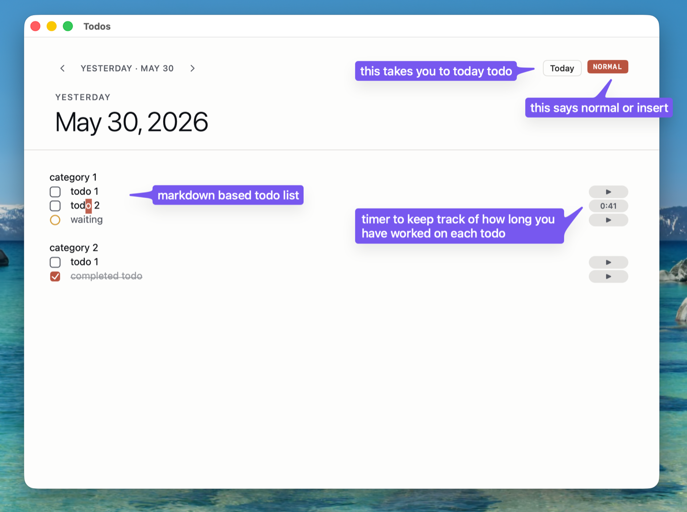
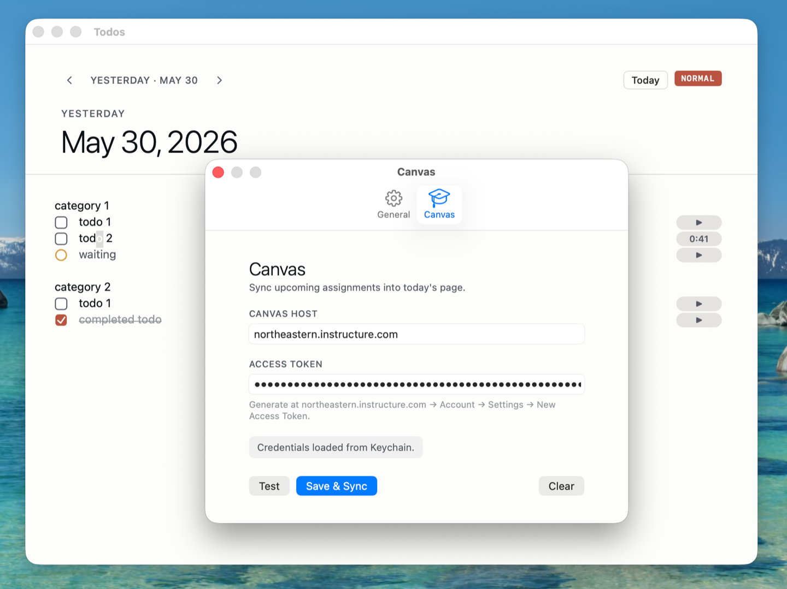
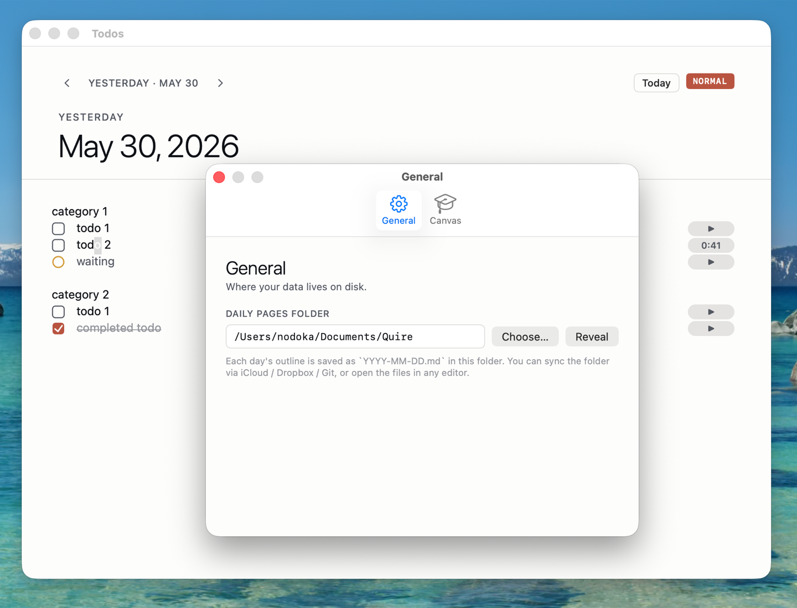

i’m nodoka. this writing is my updated / continuation of [my macos I]() blog.

i set up my `macos II blog` long time ago and i have been meaning to post this but i have not had enough updates worth to post. maybe now, i have enough to post, although not as volumetric as my first one.

<details markdown="1"><summary><strong>updates</strong></summary>

[05.31.2026] - v1 is published 🎉

</details>

## `killall` apps

<div class="callout callout-link">

<div class="callout-body">



</div>

</div>

I have mentioned in my previous blog that I use `option + K` for safely killing applications. Recently, I have wondered about killing **ALL** applications with one command. I set this up with [Automator (macOS)](https://en.wikipedia.org/wiki/Automator_(macOS)) and the [AppleScript](https://en.wikipedia.org/wiki/AppleScript) as shared in the reddit thread above.

<details markdown="1"><summary>code i used</summary>

```livescript
on run {input, parameters}
	set thelist to {"Apps", "Dock", "Finder", "SystemUI", "Absolutely Everything"}
	set choice to choose from list thelist with title "KillAll Options" with prompt "this app may kill all running apps and background processes without saving" OK button name "Proceed" cancel button name "Cancel" default items "Apps"
	if choice contains "Apps" then
		tell application "System Events" to set quitapps to name of every application process ¬
			whose visible is true and name is not "Finder" and name is not "Safari" and name is not "Stickies"
		repeat with a in quitapps
			quit application a saving no
		end repeat
		tell application "System Events" to try
			tell process "Safari" to set visible to false
			tell process "Stickies" to set visible to false
		end try
	end if
	if choice contains "Dock" then do shell script "killall Dock"
	if choice contains "Finder" then do shell script "killall Finder"
	if choice contains "SystemUI" then do shell script "killall SystemUIServer"
	if choice is "Absolutely Everything" then
		tell application "System Events" to set quitapps to name of every application process whose visible is true
		repeat with a in quitapps
			quit application a saving no
		end repeat
		do shell script "killall Dock; killall Finder; killall SystemUIServer"
	end if
end run
```



</details>

What is cool about setting this up using `AppleScript` instead of setting up `killall applications` directly on `Automator` is that this will also close the `Finder` window!!

## cool icons

<div class="callout callout-link">

<div class="callout-body">



</div>

</div>

I use dark mode for icons on my macbook nowadays but apps like `WhatsApp` do not natively have a black icon on mac which is why I would set it manually using one of the icons in macosicons.com.

funny enough, I found about this website because I was looking for icons for the `killall` app.

## my own todo list app

<div class="callout callout-link">

<div class="callout-body">



</div>

</div>

I mentioned in my [my macos I]() that I use [logseq](https://github.com/logseq/logseq) for daily todo list management. I like that [logseq](https://github.com/logseq/logseq) is open sourced, markdown-based (allows vim) and that it generates a journal everyday automatically. some gaps I saw in logseq is that vim control is semi-broken, design is ugly, it has no canvas integration (as notion does) and it does not carry forward tasks automatically.

I have fixed all these gaps in my app [quire](https://github.com/nodokashibasaki3/quire) which is a macos native app built in swift. a *quire* is a set of four sheets of paper folded together to form eight leaves which is the building block of an old-school notebook. my hope is that this application gives me the minimal features needed to track my todo tasks cleanly.

this app has its own quirks that could use some debugging… lol







## macos settings

I realize, I never talked about macos settings.

#### make cursor speed faster

1. go to `System Settings`
1. go to `mouse` (or `trackpad` if you are using the built-in trackpad)
1. adjust `tracking speed` to be the fastest 🐇

you can also run:

```shell
defaults write -g com.apple.mouse.scaling 5
```

to make it faster than what System Settings allow. I have it set to 5.

#### turn off acceleration

run:

```shell
defaults write .GlobalPreferences com.apple.mouse.scaling -1
```

#### customize the dock

1. double click on the dock
1. set:
   1. `Position on screen` → Left
   1. turn `Magnification` → On
   1. adjust the `Magnification` slider to preferred size

having dock on the left instead of bottom allows optimizing the limited space on your macbook. since most work on mac is vertical (programming, terminal, PDFs), having a bottom dock reduces the height available to these windows.

#### turn on accent popup

this means if i press on `k` for long time, it will `kkkkkkkkkk` . this is necessary for using vim on macbook. otherwise, you will have to press on `k` every time you want to move down.

to do this, run:

```shell
defaults write -g ApplePressAndHoldEnabled -bool false
```

#### maximize screen space

1. go to `System Settings` → `Displays`
1. change the resolutions to be higher to have more space.

I used to have mine set to 2058 x 1329 on my 13 inch macbook. currently, I use the default 1728 x 1117 on my 16 inch.

## end

i do not have much content here but i believe these are mildly significant updates. i am still curious about `openclaw` and i want to try to deploy it🦞
