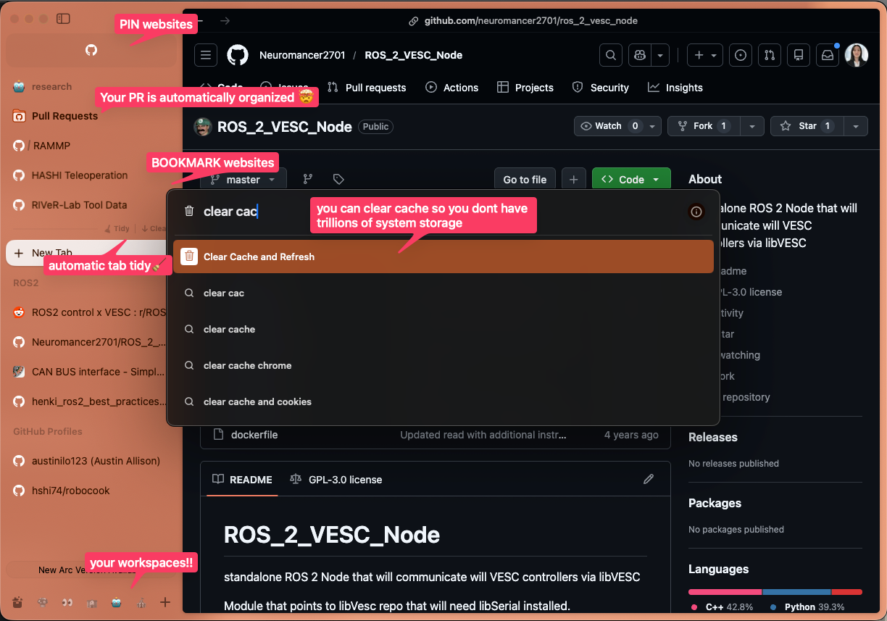

i’m Nodoka.

my obsession with random apps probably started in elementary school when i made business cards in word just for fun. i liked exploring what software could do. in middle and high school i got into Google Sheets and Notion, then started experimenting with extensions and small scripts. i then used [Google Colab](https://colab.research.google.com/) to automate parts of it because i wanted custom functions that i could not find anywhere.

in 2025 i learned `nvim` and spent HOURS on `linux` which pulled me into terminal tools and keyboard workflows. since then i’ve just kept exploring whatever catches my interest. today i’ll share my current flow, the result of years of being curious about software.

> 📣 📣
>
> I would like to make a special shoutout to my friend, Alan Huang from OMRON, who introduced me to many of the apps listed here.
{: .callout}

### TLDR🤓

<details markdown="1"><summary>TLDR I use these apps:</summary>

- [neovim](https://github.com/neovim/neovim) with [kickstart.nvim](https://github.com/nvim-lua/kickstart.nvim)
- [Rectangle](https://rectangleapp.com/)
- [AltTab - Windows alt-tab on macOS](https://alt-tab-macos.netlify.app/)
- [Arc from The Browser Company](https://arc.net/)
- [Vimium C - All by Keyboard - Chrome Web Store](https://chromewebstore.google.com/detail/vimium-c-all-by-keyboard/hfjbmagddngcpeloejdejnfgbamkjaeg)
- [PDF Viewer for Vimium C - Chrome Web Store](https://chromewebstore.google.com/detail/pdf-viewer-for-vimium-c/nacjakoppgmdcpemlfnfegmlhipddanj?authuser=1&pli=1)
- [Raycast - Your shortcut to everything](https://www.raycast.com/)
- [Shottr](https://shottr.cc/)
- [Notion Desktop App for Mac & Windows \| Notion](https://www.notion.so/desktop)
   - pro is free with [GitHub Education](https://github.com/education)
- [Notion Calendar](https://www.notion.com/product/calendar)
- [A privacy-first, open-source knowledge base](https://logseq.com/)
- [iTerm2 - macOS Terminal Replacement](https://iterm2.com/)
- [Remote Desktop Software for macOS \| AnyDesk](https://anydesk.com/en/downloads/mac-os)
- [Docker: Accelerated Container Application Development](https://www.docker.com/)
- [Google Antigravity](https://antigravity.google/)
- [Zotero \| Your personal research assistant](https://www.zotero.org/download/)

</details>

<details markdown="1"><summary>Updates</summary>

> [2025/02/21]  Published
>
> [2025/02/27] Transferred Shell Tools to [NEW PAGE](/blog/shell-toolkit-i/)
>
> [2025/03/10] Updated [Raycast Optimization](/blog/raycast-toolkit/)

</details>

## How it all started… `Neovim`

*Why did I start using Neovim?* At my internship, every shared machine had `nvim` setup, so I eventually gave in.

Funny enough, at first, I basically spammed `i` and lived in insert mode.

> [neovim](https://github.com/neovim/neovim)
>
> Modern Vim-based text editor extensible in Lua for high-performance workflows.
{: .callout}

What `neovim` changed for me:

- full keyboard navigation
- faster movement across text and files (`gd` is my fav)

I highly recommend to use [kickstart.nvim](https://github.com/nvim-lua/kickstart.nvim) config. If you get confused you can follow [The Only Video You Need to Get Started with Neovim](https://www.youtube.com/watch?v=m8C0Cq9Uv9o) by the creator of kickstart (a.k.a legend 👑).

> After I got used to that workflow using a trackpad on my personal macOS machine started to feel slow. Especially since company Ubuntu has strong window management, but macOS does not.

## macOS Window Management

> [Rectangle](https://rectangleapp.com/)
>
> macOS window manager that lets you resize and position windows using keyboard shortcuts.
{: .callout}

I use Rectangle instead of the native macOS window management because:

- closer to ubuntu feel (faster)
- move across monitors
- more customization

I have my shortcut keys set to:

- `Ctrl + Alt + l`: Move to right side
- `Ctrl + Alt + h` : Move to left side
- `Ctrl + Alt + Space` : Full Screen

other than this, I have `Ctrl + Alt` + { `k` , `i` , `u` , `j` } to snap a window to each of the four corners.

> But we still do not have alt-tab like Windows or Linux

## AltTab

> [AltTab - Windows alt-tab on macOS](https://alt-tab-macos.netlify.app/)
>
> macOS app that brings Windows-style `Alt + Tab` window switching, letting you quickly cycle through open windows using only the keyboard.
{: .callout}

macOS does have native switching, but it’s different. macOS only has `Cmd + Tab`, which switches through all open applications, not individual windows. Nothing else. For reference, Linux has `Alt + Tab`, which cycles through each open window across apps.

That’s what AltTab adds to macOS.

I have it setup so that:

- `Alt + Tab` : Switch between open windows in the current Desktop
- `Alt + `` : Switch between the windows of currently selected Application

> But this poses new ambition to not use the touchpad on browser…

## Arc Browser

> [Arc from The Browser Company](https://arc.net/)
>
> Chromium-based browser with workspace-driven tab organization and profile isolation. You can move around the workspaces using your keyboard.
{: .callout}

the coolest part is you can set custom keyboard shortcuts to navigate around your tabs and workspaces. here are mine:

- `Cmd + Alt + l` : Next Workspace (”right”)
- `Cmd + Alt + h` : Previous Workspace (”left”)
- `Cmd + Alt + k` : Previous Tab (”up”)
- `Cmd + Alt + j` : Next Tab (”down”)

and there are some other ones like `Cmd + Shift + c` (copy tab link), `Cmd + [` (go back) and `Cmd + ]` (go forward) that are useful and unique to Arc Browser.

and, no more tabs so small you cant see the tab title…



> But you still can’t move around individual browser windows the way you can move through text in Vim. That’s when I discovered Vimium, though, spoiler, I don’t use it anymore.

## Vimium

> [vimium](https://github.com/philc/vimium)
>
> browser extension that provides keyboard-based navigation and control of the web in the spirit of the Vim editor.
{: .callout}

> I thought, now I can navigate the browser with just my keyboard!
>
> Then I opened a PDF… and realized I still couldn’t 😞

## Vimium C

> [vimium-c](https://github.com/gdh1995/vimium-c)
>
> fork of vimium with an advanced omnibar.
{: .callout}

I use Vimium C now because I found [PDF Viewer for Vimium C - Chrome Web Store](https://chromewebstore.google.com/detail/pdf-viewer-for-vimium-c/nacjakoppgmdcpemlfnfegmlhipddanj?authuser=1&pli=1) which only works with Vimium C. It lets me navigate PDFs with the keyboard, which fixed the one place where things were still breaking my flow!!

> but, i was not moving around my computer (Mac) mostly with my touchpad. then, my friend introduced me to Raycast 🐐🐐

## Raycast

> [Raycast - Your shortcut to everything](https://www.raycast.com/)
>
> Keyboard-first macOS launcher for apps, scripts, window management, and automation.
{: .callout}

It is like Spotlight, but better (so as fans claim). I never used spotlight but, all I know is that once I started using Raycast, my workflow improved immediately.

I can spend HOURS talking about Raycast. Some basic stuff I use on daily if not hourly basis are:

- [Quicklinks](https://manual.raycast.com/quicklinks)
- [Snippets](https://manual.raycast.com/snippets)
- [Emoji Picker](https://manual.raycast.com/windows/emoji-picker)
- [Clipboard History for Mac \| Raycast](https://www.raycast.com/core-features/clipboard-history)
- [File Search](https://manual.raycast.com/windows/file-search)
- [Raycast Store: Kill Process](https://www.raycast.com/rolandleth/kill-process)

you could also use their window management, i like [Rectangle](https://rectangleapp.com/) better because i have multiple displays. Raycast management does not move windows across monitors.

~~I can have another blog for this… and I am yet to find good resource outlining useful shortcuts.~~

Raycast Toolkit Written ✅

[my raycast toolkit](/blog/raycast-toolkit/)

> but what about when you take screenshots?
>
> Racing to press `Cmd + C` before the preview disappears from the bottom corner? I was.

## Shottr

> [Shottr](https://shottr.cc/)
>
> Fast screenshot and annotation tool with scrolling capture and OCR support.
{: .callout}

After I started using Shottr, I realized macOS already lets you set separate shortcuts to copy or save screenshots. So technically, you don’t need another app.

Shottr adds a step:

1. screenshot
1. preview opens
1. then `Cmd + C` or `Cmd + S`

It’s **NOT** faster. The only real benefit is quick editing right after capture.

F.Y.I [Take a screenshot on Mac - Apple Support](https://support.apple.com/en-us/102646)

> with this build, I am not able to navigate around the entire computer with just computers.
>
> so **I re-structured my data and task management.**

## Getting to Data Management… Notion

> [Notion Desktop App for Mac & Windows \| Notion](https://www.notion.so/desktop)
>
> All-in-one workspace for databases and time management. Students can get Notion Pro for free through [GitHub Education](https://github.com/education)
{: .callout}

Since I began using Notion in high school, this application has made amazing advancements! But I agree that how I have changed to use it also made my experience better:

- type in `Markdown` ; I used to select and edit each word. This takes too long.
- use `/` to bringup blocks; stopped using `+` button.
- use it for Shared Data rather than for managing tasks.
   - I use another `Markdown` based application for task management.
- have simple layout with Space for each segment of my life
   - Robots 🤖 ← db of project and daily log tracking
   - Job Search 👀  ← db of job and cover letter tracking
   - Academics 🏫  ← db of assignments and class grade weighing
   - Entertainment 💃  ← db of travel plans and music
   - (Shared DB 📁)  ← just a db of shared doc

One task I do manage on Notion is Canvas assignments using [Notion Canvas Assignment Import - Chrome Web Store](https://chromewebstore.google.com/detail/notion-canvas-assignment/elbkjcjgakaoccocmbglokgmalkoacie). This tool automatically uploads your Canvas Assignments to Notion. This proved to be helpful because I extensively also use Notion Calendar.

One thing that annoys me is I cannot use `nvim` on here. This guy from my internship built [Vimtion: Vim for Notion - Chrome Web Store](https://chromewebstore.google.com/detail/vimtion-vim-for-notion/omcehhihhemhincacmandepjhhnjfeoo) for Notion Browser though, super neat!

> Notion Calendar is goated, probably more than Notion itself.

## Notion Calendar

> [Notion Calendar](https://www.notion.com/product/calendar)
>
> All of your commitments, now in one place. Meet the beautifully designed, fully integrated calendar for your work and life.
{: .callout}

Notion Calendar only came out 2 or 3 years ago. When it was in Beta it was terrible but now, it is the best one out there. And it’s completely free.

Basic stuff it can do:

- read and edit Google Calendar
- suggest new time for calendar invite
- end calendar invite with auto Google Meets or Zoom meeting info
- textiles your availability by selecting times.

Though, these things, I assume every calendar apps can do.

What makes Notion Calendar goated 🐐:

- pretty design
- it can be controlled completely by keyboard
   - `t`  = go to today
   - `m` = monthly calendar
   - `w` = weekly calendar
   - shortcuts are also editable
- you can integrate Notion db into Notion Calendar
   - My assignments auto-sync from a Chrome extension into a Notion database, which shows up on my Notion Calendar. So when I open my calendar, I see what’s due that day.
   - I schedule my internship hours on Notion Calendar, which is linked to a daily log database. That way my team can see when I’m coming in and what I worked on.

**Limitations** i found (and semi-fix):

- only read-only access to Microsoft Calendar
- limited colors (this can be overcome by using GCal import)

> 💬 💬
>
> **Side Note:** **Apple Calendar**
>
> It has pretty design and **CAN** edit Teams Calendar unlike Notion Calendar.
>
> But, you cannot navigate using your keyboard (unless you use external tool like [folivora.ai - Great Tools for your Mac!](https://folivora.ai/)), and cannot import Notion db. Depending on the implementation, it is better than Notion Calendar.
{: .callout}

> well now what? seems like we are fully setup! no. we need a good daily task management… preferably open sourced because data is important!!

## Logseq

> [A privacy-first, open-source knowledge base](https://logseq.com/)
>
> Local-first, graph-based knowledge management tool with bidirectional linking.
{: .callout}

`Logseq` is date-based, which matches how I plan my days. Each day generates a local `.md` file, and I use Vim mode inside `Logseq`, so everything stays keyboard-driven. I track habits, goals, communication notes, and draft my daily schedule there. The `todo` plugin logs task duration, which surfaces how I actually spend time. I keep generic tasks like `do homework` there instead of on my calendar to preserve visual space.

<details markdown="1"><summary>my <code>journal</code> format</summary>

#### 🗓️ Date

1. wake up @ time
1. do something @ time
1. sleep @ time

---

#### Classes

[[School]]          ← links to data

- **class 1**
   - TODO something            ← i dont use the school section as
- **class 2**                                           much but i have this for time flow

---

#### Others

[[At the end of the day]]]]

- 💬 **communication**
   - TODO Email
   - TODO LinkedIn
   - TODO iMessages
- 🤖 **robots**
   - TODO something
- 💼 **job search**
   - ~~DONE apply~~
- 🎧 **music**
   - TODO meeting stuff
- 🧑‍💻 **extra curricular I**
- 🧑‍💻 **extra curricular II**
   - DOING build something    ← shows on right how much time spent
- 💃 **hobby**

</details>

The file starts blank everyday. Instead of manually copying unfinished items forward, I wrote a small script to carry them over.

<details markdown="1"><summary>my <code>create_journal.sh</code> script</summary>

```shell
#!/usr/bin/env bash
set -euo pipefail

JOURNALS_DIR="$HOME/Desktop/dev/logseq/journals"

TODAY="$(date +%Y_%m_%d)"
TODAY_FILE="$JOURNALS_DIR/${TODAY}.md"

# Check if file has real content (not empty / whitespace)
has_content() {
  local f="$1"
  [[ -f "$f" ]] && grep -q '[^[:space:]]' "$f"
}

LAST_WITH_CONTENT=""

# Find newest journal with content (excluding today)
for f in $(ls -1 "$JOURNALS_DIR"/*.md | sort -r); do
  base="$(basename "$f")"

  [[ "$base" == "${TODAY}.md" ]] && continue

  if has_content "$f"; then
    LAST_WITH_CONTENT="$f"
    break
  fi
done

if [[ -z "$LAST_WITH_CONTENT" ]]; then
  echo "No previous journal with content found."
  exit 1
fi

# Overwrite today's journal (no backup)
cp "$LAST_WITH_CONTENT" "$TODAY_FILE"

echo "Copied:"
echo "From: $LAST_WITH_CONTENT"
echo "To:   $TODAY_FILE"
```

</details>

> by this point I was pretty satisfied, except, why type so much when I don’t have to?

## Spokenly

> [Spokenly – Whisper-Powered Mac Dictation App \| Best Voice to Text for macOS](https://spokenly.app/)
>
> Seamless speech-to-text in every application across your Mac and iPhone.
{: .callout}

I only started using speech-to-text apps in 2026 but has helped me to develop and gather my thoughts much faster. Spokenly is a free and high-performing option I found amongst many competitors.

> ok so now, was i satisfied? yes. yes I was! although i’m always on the search 🔎
>
> so now I started to discover some shell tools🙂
>
> **UPDATE: I transferred** **`Shell Tools`** **to** **[NEW PAGE](/blog/shell-toolkit-i/)**

## Unrelated to Optimization but in my workflow…

### [Remote Desktop Software for macOS \| AnyDesk](https://anydesk.com/en/downloads/mac-os)

Lightweight remote desktop software for secure access and support. They briefly restricted free use in 2025, but it’s free again. AnyDesk has low latency and responsive screen updates. You can set passwords for unattended access and restrict login to approved users.

### [Docker: Accelerated Container Application Development](https://www.docker.com/)

Container runtime and GUI for building and managing containers locally on macOS. Takes up half of my storage but cost of having a macOS.

### [Google Antigravity](https://antigravity.google/)

Agentic IDE developed by Google, fork of VS. Was pretty skeptical in November, 2025 when it launched but I now use Antigravity and VS the same amount. Still has some minor bugs.

### [Zotero \| Your personal research assistant](https://www.zotero.org/download/)

Open-source reference manager for organizing research and generating citations. Cannot manage my papers without Zotero (bless).
