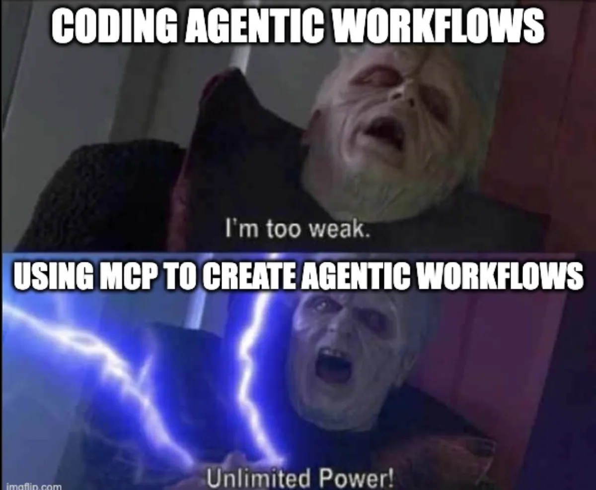

i’m [Nodoka Shibasaki \| Northeastern University](https://nodokas.com/).

this is development log of my open-source contribution to [notion-assignment-import](https://github.com/JamesNZL/notion-assignment-import). in my Blog [my macos I](/blog/macos-setup-i/) I mentioned that I use [Notion Canvas Assignment Import - Chrome Web Store](https://chromewebstore.google.com/detail/notion-canvas-assignment/elbkjcjgakaoccocmbglokgmalkoacie) to pull Assignments from Canvas to Notion database.

i decided to build a better version of this for myself and others. after a few hours of digging into Chrome internals and TypeScript since midnight, I finally got it working.

> *"In real open source, you have the right to control your own destiny"*
>
> — Linus Torvalds (Creator of Linux, a.k.a open source legend👑)

## Where the heck do I start…

when I forked [notion-assignment-import](https://github.com/JamesNZL/notion-assignment-import) I had one goal: no more manual imports.

the way the original plugin works is repetitive. you have to open every course page individually and click `import` for every single class. I didn't see why this couldn't just be automated so I wouldn't have to click through everything.

the motivation was clear, but I had one obvious problem: I didn’t know `typeScript` or `mcp`. I spent a good hour just staring at the codebase, realized I didn't understand a single line, and ended up back on youtube just to figure out the absolute basics before I could even start.

> **how I started 📹:**
>
> - [typeScript crash course](https://www.youtube.com/watch?v=BwuLxPH8IDs) - watching selective snippets was enough.
> - [MCP clearly explained](https://www.youtube.com/watch?v=7j_NE6Pjv-E) - crash course on integrating these new agentic tools.
>
> 
{: .callout}

## Figured out what I need to do to achieve my goal!

have a background service worker would wake up on a `chrome.alarms` trigger, fetch the latest data, and update the Notion database. seems simple enough, I got to hacking 50 minutes after midnight.

## Then, an hour into coding, hit a wall 🐞

when [Extensions / Manifest V3  \|  Chrome for Developers](https://developer.chrome.com/docs/extensions/develop/migrate/what-is-mv3) (the new, stricter set of rules for chrome extensions) started being my worst nightmare, i tried to fire the sync function in the background. i was half-asleep so i couldn't tell if it was an actual nightmare, but then everything *silently* exploded 💥 so yes, this was very real.


the funniest part was that because of how `manifest v3` uses `service workers`, scripts ran in the background without a browser tab, but there was no error message on the screen. everything just **stopped 😵‍💫**. even funnier, i was actually enjoying this new challenge at 1 am.

i had to dig into the background console only to find a wall of `errors`:

```bash
ReferenceError: alert is not defined
ReferenceError: window is not defined
ReferenceError: document is not defined
```

> ⚠️ **The DOM Dependencies**
>
> the original `exporttonotion` logic was tightly coupled to the UI. it assumed it was running in a popup and repeatedly tried to call `alert()` to handle errors. `service workers` don't have a `window` object (the browser window), so every time an error fired, the worker crashed instantly because it didn't know what an `alert` was.
>
> the real headache was [domparser](https://github.com/thednp/domparser). `domparser`is a high-level library that converts html strings to the DOM tree that can be queried. the original logic used it to scrape assignment data from canvas `html` strings. that works in a normal browser tab, but `service workers` are headless meaning they have no "page" to look at. since they have no `window` or `document`, `DOMParser` just doesn't exist there. i had to follow the export logic and strip out all browser-specific UI dependencies so it could run blindly in the background.
{: .callout}

> ✨ **Fix to DOM issue…**
> ultimately, the main fix was moving away from `domparser`. since i couldn't use the browser's built-in tools to read the canvas html, i had to find a way to parse the data "blindly." i ended up using a lightweight library called [cheerio](https://github.com/cheeriojs/cheerio) (or a similar html-to-json logic). it allowed me to treat the canvas assignments like a simple data structure rather than a live webpage.
{: .callout}

right after solving that `refactor`, i hit the next wall 😞

## What the heck is a Bundler

If you’re wondering what a bundler even is, don’t worry I also had no idea until last night. it basically compiles your `typescript` into `javascript` and packages all your files together so chrome can actually run the extension.

> ⚠️ **ESM Module**
>
> to use modern imports in `background.ts`, i added `"type": "module"` to the manifest. but here’s the problem: the extension relies heavily on `moment-timezone`.
>
> the legacy `gulp` and `browserify` build pipeline (the tools used to "link" the code) completely choked trying to resolve those third-party dependencies inside an isolated `service worker` bundle. nothing would compile because the old tools didn't know how to handle the new module format.
{: .callout}

after hitting a dead end with the legacy tools, i decided to scrap the `gulp` and `browserify`pipeline entirely.

> ✨ **fix? i switched to** [bun](https://github.com/oven-sh/bun)**.**
>
> *what is that? you may ask.* it’s actually sick! `bun` is an all-in-one toolchain (written in **zig**) that handles everything. coming from low-level dev, this felt way more natural. it’s basically the difference between a slow, clunky build script and a high-performance native compiler!!
{: .callout}

It solved my problems with bundler almost instantly. instead of fighting with the legacy "linker" that couldn't handle the new `esm` modules, [bun](https://github.com/oven-sh/bun) just understood them. it took my disorganized pile of `typescript` and `moment-timezone` dependencies and squashed them into a clean `background.js` file in milliseconds.

then, I shipped!

## What did I ship? what did I learn? next steps?

i managed to push through and get the core automation working. here’s the breakdown:

- background automatic syncing using `Service Worker Alarms` .
- smart extraction of Canvas URL.
- customize sync intervals.
- refactor the entire Notion export pipeline to be environment-agnostic.

surprisingly, I **learned** a lot in these three hours…

> <details markdown="1"><summary>1. service workers are RUTHLESS 😭</summary>
>
> they demand total isolation. no `window`, no `document`, and definitely no `alert()`. unlike bare-metal programming where you can usually reach out and touch any peripheral, `manifest v3` traps you in a  sandbox with zero visibility into the ui. thus, abstracting your logic is the only way to keep the code from crashing.
>
> </details>
>
> <details markdown="1"><summary>2. bundlers HATE background scripts 👎</summary>
>
> trying to link external modules like `moment-timezone` into an isolated background worker is a nightmare. it requires a perfectly tuned pipeline, or the whole thing just chokes.
>
> </details>
>
> <details markdown="1"><summary>3. the best UI is NO UI 🙅‍♀️</summary>
>
> scouring local storage for existing data is infinitely better than forcing the user to fill out another settings field. if the data is already there, just use it.
>
> </details>
{: .callout}

### What is Next?

- [x] Submit initial PR for automated background service worker
- [ ] kill  [gulp](https://github.com/gulpjs/gulp): successfully migrated away from the legacy pipeline.
- [ ] implement exponential backoff for notion api rate limits so the background worker doesn't get blocked.
- [ ] automated tests for the origin extraction logic with [vitest](https://github.com/vitest-dev/vitest)

## Extra: my setup for this contribution ✨

> I mentioned in [my macos I](/blog/macos-setup-i/) that I used iTerm and even said, "I do not need it to be fast." Then I actually realized how slow it was through this project.

> 
>
> GPU-accelerated terminal, much needed for this development.
{: .callout}

> 
>
> cool multiplexer.
{: .callout}

I had

- running the **`bun build --watch`** script
- another for Chrome Service Worker logs.
- another for `zsh-autocomplete-2026` commands.

i also utilized the sequential thinking mcp server to break down the complex codebase jumps. it was helpful when mapping out how the existing `storage` api connected to the popup's state.

> for those interested in the repo.
>
> 
{: .callout}

thanks for reading👋
