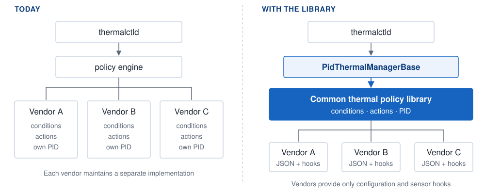
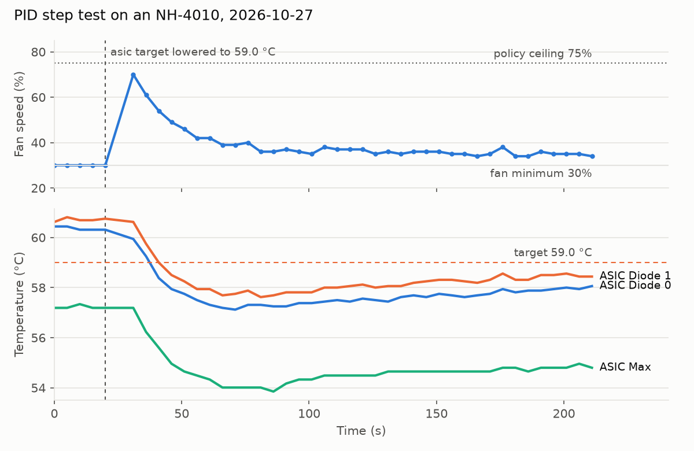
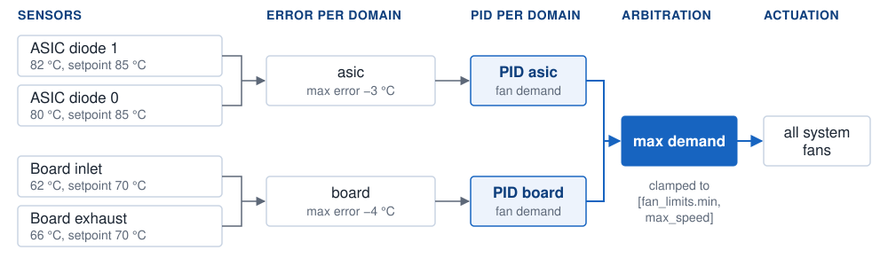

recently, i had the opportunity to intern under the [Linux Foundation](https://www.linuxfoundation.org/) where I recieved close mentorship from Lotus Fenn, a software engineer at [Nexthop AI](https://www.nexthop.ai). Through this program, I contributed to [SONiC](https://sonicfoundation.dev/) and learned more about the open source community.

<strong>updates</strong>

[11.20.2026] - v1 is published 🎉

## what is SONiC, and what did i do?

SONiC is an open-source [network operating system](https://en.wikipedia.org/wiki/Network_operating_system) often used in large scale data centers. originally developed and maintained by Microsoft, currently, the Linux Foundation is the maintainer. SONiC is used by numerous companies including Microsoft, Dell, Nokia, and others.

my project was to unify the thermal control system in SONiC for easier adoption by vendors.

there is a service called [`thermalctld`](https://github.com/sonic-net/sonic-platform-daemons/tree/master/sonic-thermalctld). it reads temperature sensors and adjusts fan speeds, usually with a [PID controller](https://en.wikipedia.org/wiki/Proportional%E2%80%93integral%E2%80%93derivative_controller). the problem was that every vendor had to write their own version of that same code.

so i built a shared thermal policy library in [`sonic-platform-common`](https://github.com/sonic-net/sonic-platform-common) which separates policies from the controller logic. vendors can adopt it with two config files and two small functions that describe their sensors. in return, they get a tested PID controller, reusable policies, config validation, and a fail-safe that sets the fans to full speed when something goes wrong. i tested it on an [NH-4010](https://siliconangle.com/2026/03/10/ai-networking-startup-nexthop-ai-raises-500m-launches-new-switches/) switch at the [UNH-IOL](https://www.iol.unh.edu/) lab. i set the [ASIC](https://en.wikipedia.org/wiki/Application-specific_integrated_circuit) target a little below the hottest sensor reading. the fans went up to 70%, stayed under the 75% limit, and settled at about 35% within a minute. then i removed the config file on purpose, just to see what would happen. all the fans went to 95% or higher. that was the fail-safe working, which was a relief to actually see in real life.

<!--  -->

i also wrote the [high-level design doc](https://github.com/sonic-net/SONiC/pull/2616) and opened three pull requests ([library](https://github.com/sonic-net/sonic-platform-common/pull/786), [example adoption](https://github.com/sonic-net/sonic-buildimage/pull/30397), [design doc](https://github.com/sonic-net/SONiC/pull/2616)). and i built an emulated [FPGA](https://en.wikipedia.org/wiki/Field-programmable_gate_array) [I2C](https://en.wikipedia.org/wiki/I%C2%B2C) device in [QEMU](https://www.qemu.org/), so driver tests can run without physical hardware.

## i spent the first few weeks just reading

when i joined in May, i knew almost nothing about SONiC or platform drivers. SONiC lives across a few different repos, and each one has its own build system and its own way of doing things. i could read a file and understand that file, but i could not see how it all fit together yet. using [claude](https://claude.ai), [mermaid](https://mermaid.js.org/) and youtube, i was able to understand the key concepts and the overall system in a week or two.

> 📺 good videos i found:
>
> - [SONiC: the networking switch software that powers the Microsoft Global Cloud](https://learn.microsoft.com/en-us/shows/azure/sonic-networking-switch-software-that-powers-microsoft-global-cloud) by Microsoft
> - [Hub, Switch, & Router Explained](https://www.youtube.com/watch?v=1z0ULvg_pW8) by PowerCert
> - [What is a Network Switch and How Does it Work?](https://www.youtube.com/watch?v=9eH16Fxeb9o) by NetworkChuck
> - [PID Controller Explained](https://www.youtube.com/watch?v=fv6dLTEvl74) by RealPars
> - [What Is PID Control?](https://www.youtube.com/watch?v=4Y7zG48uHRo) by MathWorks
{: .callout}

Lotus also spent a lot of time explaining platforms and PID control to me, and how the code connected to real hardware. our discussions were my favorite part! things started to click through putting thoughts into words, and once they did, i could actually think about trade-offs instead of just trying to keep up.

i also learned what it takes to get work ready for reviewers. you have to explain why you are doing it, not just what you changed. you have to make sure you are not breaking things for vendors who do not use your library. and you have to test it on real hardware before you ask anyone to trust it.

## why i think everything should be open

when every vendor kept their own copy of the same fan controller, a fix in one place did not help anyone else. a config mistake could just sit there, unnoticed. and a failure could leave the fans uncontrolled while the system still said everything was fine.

sharing one tested library fixes that in a very practical way. a fix helps everyone at once. more eyes are on the same code, so mistakes get caught earlier. and the next person does not have to start from zero.

i keep thinking about that in robotics too. my main work is robot manipulation. we are all solving similar problems, a lot of the time in parallel, behind closed doors. if we shared more, we could build on each other instead of rebuilding the same thing.

i believe most science and technology should be open. for me, the point of science is to improve the world together.

we do research to figure something out. then we share it, so others can use it, try to reproduce it, question it, and make it better. if we keep it closed, we are not really doing that together. we are just racing to be first.

i want to keep open-sourcing my research because of that. i want the tools and ideas i build to be useful to someone else, not just to me. if i learned something, i want to share it in a way that helps the next person learn it faster.

thank you to Lotus, for mentoring me. thank you to Evan Harrison, who runs the SONiC Mentorship Program. thank you to Saikrishna Arcot from Microsoft, who runs the weekly SONiC community meeting. and thank you to [LFX](https://mentorship.lfx.linuxfoundation.org/) and the SONiC community for letting a new contributor work on a real problem.